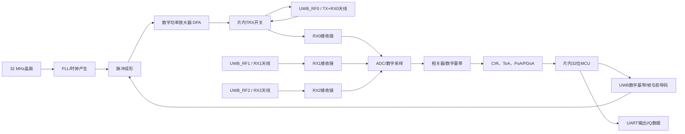
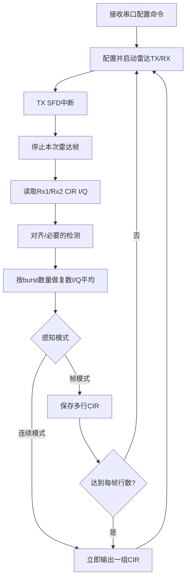

# CBU5000V210 UWB 的 I/Q、CIR、射频天线与雷达原理说明

> 文档日期：2026-10-26  
> 适用范围：CBU5000V210 雷达测试固件、当前客户硬件、GD32E230K8U6 串口转发工程及 Radar CIR Clutter View 上位机  
> 资料依据：芯邦 CBU5000V210 数据手册、硬件设计指南、Radar Test APP Manual rev0.5、当前 UWB/GD 源码，以及文末列出的公开技术资料  
> 说明：文中的通用无线电和信号处理原理适用于多数 UWB 系统；引脚、参数、帧格式和数值以当前项目版本为准。

## 1. 先回答：I 和 Q 分别是什么

I 和 Q 是同一个接收信号在两个互相正交的参考载波上的投影：

- **I：In-phase，同相分量**，参考方向为 0°；
- **Q：Quadrature，正交分量**，参考方向相对 I 相差 90°。

接收机把 GHz 频段的高频 UWB 信号下变频到复数基带后，用一个复数表示某个时刻或某个 CIR Tap 的信号：

```text
h[n] = I[n] + j·Q[n]
```

其中 `j` 是数学上的虚数单位。I 和 Q 都是有符号数，可以为正、为负或为零。它们不是：

- 两根天线各自的强度；
- 发射信号和接收信号；
- 水平极化和垂直极化；
- 两个彼此独立的目标。

每一路接收通道都有自己的一整组 I/Q。例如本项目输出：

```text
Rx1：I1[0...N-1]、Q1[0...N-1]
Rx2：I2[0...N-1]、Q2[0...N-1]
```

从 I/Q 可以计算幅度和相位：

```text
幅度：A[n] = sqrt(I[n]^2 + Q[n]^2)
功率：P[n] ∝ I[n]^2 + Q[n]^2
相位：φ[n] = atan2(Q[n], I[n])
```

例如某个 Tap 的 `I=3000、Q=-1800`：

```text
A ≈ 3499
φ ≈ -31°
```

所以，I/Q保留的信息比只看幅度更多：

- 幅度反映这一距离单元收到的综合回波强弱；
- 相位可用于微位移、速度、呼吸、天线间相位差和到达角计算；
- 多帧 I/Q 的变化可用于区分静态环境与运动目标。

Analog Devices 对 I/Q 的定义和正交解调原理可参考：[I/Q 定义](https://www.analog.com/en/resources/glossary/iq.html)、[宽带直接变频接收机原理](https://www.analog.com/en/resources/design-notes/2023/11/21/07/11/optimizing-performance-wideband-direct-conversion-receivers.html)。

## 2. UWB 是什么

UWB（Ultra-Wideband，超宽带）使用很宽的射频带宽发送很短的脉冲或等效宽带波形。FiRa 的公开说明将 500 MHz 或以上带宽作为 UWB 的典型特征，并说明 UWB 通过短脉冲和精确时间测量实现测距与定位。[FiRa UWB 技术说明](https://www.firaconsortium.org/node/727)

CBU5000V210 数据手册给出的 UWB 主要射频参数为：

| 项目 | CBU5000V210 数据手册值 |
|---|---:|
| UWB 射频范围 | 6489.6～8486.4 MHz |
| 单信道带宽 | 499.2 MHz |
| 架构 | 1T3R：1 路发射、3 路接收 |
| UWB 射频端口 | RF0 为 TX/RX0 共用；RF1 为 RX1；RF2 为 RX2 |
| 端口阻抗 | 面向 50 Ω 天线/滤波器连接 |
| 参考时钟 | 32 MHz 晶振，片内 PLL 产生射频和数字时钟 |

UWB 的“宽带”带来两个直接好处：

1. 脉冲的时间边沿很窄，接收机能更精确地估计到达时间；
2. 不同传播路径在时间上更容易被分开，适合构造 CIR、测距和雷达感知。

但需要区分以下三个概念：

| 概念 | 含义 | 本项目中的理解 |
|---|---|---|
| Tap 间隔/显示步进 | 相邻 CIR 样点对应的距离间隔 | 原厂手册约 15.024 cm/Tap |
| 距离分辨率 | 能否把两个相邻目标区分为两个峰 | 受带宽、窗函数、信噪比和算法影响；通常不等于 Tap 间隔 |
| 测距精度 | 对单个路径到达时间估计的误差 | 可通过相关峰插值、前沿检测和标定做到小于原始距离单元 |

以 499.2 MHz 带宽估算，单站雷达的经典原始距离分辨率约为：

```text
ΔR ≈ c / (2B) ≈ 3×10^8 / (2×499.2×10^6) ≈ 0.30 m
```

因此，“Tap 约 15 cm”不表示一定能把相隔 15 cm 的两个目标稳定分开，也不表示测距精度只能到 15 cm。

### 2.1 “499.2 MHz 带宽”到底表示什么

先把一个射频信号想象成占据频率轴上的一段“车道”：

```text
功率
  ↑                     单个UWB信道
  │                  ┌──────────────┐
  │                ／                  ＼
  │______________／______________________＼______________→ 频率
                         ← 499.2 MHz →
                              ↑
                            中心频率 fc
```

`499.2 MHz` 描述的是这段信号从较低频率延伸到较高频率的**频率跨度**，即单信道射频带宽 `B`。如果某一信道中心频率为 `fc`，可用下式直观表示其频率范围：

```text
大致下边界：fc - B/2
大致上边界：fc + B/2
B = 499.2 MHz
```

实际频谱边缘不会像方框一样突然截止，工程上还必须说明按什么功率门限测量带宽，例如占用带宽、`-10 dB` 带宽或法规规定的测量方法。因此，`499.2 MHz` 是信道的标称带宽，真实有效带宽还会受到脉冲成形、滤波器、天线、PCB 和接收机响应影响。

CBU5000V210 数据手册中的两个数字含义不同：

| 数据手册参数 | 正确理解 | 不应理解为 |
|---|---|---|
| 射频范围 `6489.6～8486.4 MHz` | 芯片可工作的整体射频频率范围或多个可选信道所覆盖的范围 | 一次发射同时占满约 2 GHz |
| 单信道带宽 `499.2 MHz` | 当前选中一个 UWB 信道时，信号占据的标称频率宽度 | 信号中心频率、PRF、串口波特率或 ADC 采样率 |

也就是说，芯片工作在约 6.5～8.5 GHz 的高频区域，而一次 UWB 发射使用其中约 499.2 MHz 宽的一段频谱。GHz 量级的中心频率主要决定载波波长、天线尺寸和传播相位；499.2 MHz 的带宽主要决定脉冲时间尺度、时间分辨能力和原始距离分辨率。

### 2.2 为什么频带越宽，脉冲可以越短

时间和频率存在一对基本关系：信号在时间上越短，通常需要由越多不同频率成分共同合成。可以用声音作类比：

- 持续很久的纯音接近单一频率，频带很窄，很难准确判断它“从哪一个瞬间开始”；
- 一声短促的拍手或点击包含很多频率，频带很宽，开始时刻非常清楚；
- UWB 短脉冲更像“射频点击声”，接收机可通过相关运算找到其到达时刻。

对带宽为 `B` 的信号，其可分辨的典型时间尺度与 `1/B` 同量级：

```text
Δt ≈ 1 / B
```

代入本项目的 `B = 499.2 MHz`：

```text
Δt ≈ 1 / (499.2×10^6) ≈ 2.003 ns
```

电磁波在自由空间 2.003 ns 内传播的单程距离约为：

```text
c·Δt ≈ 3×10^8 × 2.003×10^-9 ≈ 0.601 m
```

但本项目是单站雷达：信号从雷达到目标再返回雷达，传播距离是目标距离的两倍，所以原始距离分辨率需要再除以 2：

```text
ΔR ≈ c·Δt/2 ≈ c/(2B) ≈ 0.300 m
```

这就是“499.2 MHz 带宽大约对应 30 cm 经典原始距离分辨率”的由来。它不是说所有测量误差一定为 30 cm，而是说两个强度相近、处在理想条件下的独立反射，如果只相隔远小于这一尺度，其相关响应通常会严重重叠，不容易显示成两个清楚分开的峰。

### 2.3 带宽、Tap 间隔、距离分辨率和测距精度的区别

这四个量非常容易混淆，可以把它们类比为“照片的光学清晰度、像素间距和定位算法”：

| 概念 | 类比 | 本项目含义 |
|---|---|---|
| 射频有效带宽 | 镜头真正能分清多细的结构 | 决定原始时间/距离分辨能力，标称为 499.2 MHz |
| CIR Tap 间隔 | 图像像素之间的坐标间距 | 手册给出约 15.024 cm/Tap |
| 距离分辨率 | 两个相邻物体能否显示为两个目标 | 499.2 MHz 的经典估算约 30 cm，还受窗函数、信噪比和旁瓣影响 |
| 单目标测距精度 | 算法对一个峰中心位置估计得多准 | 可通过插值、前沿检测、多帧平均和标定优于一个 Tap，但受系统误差限制 |

当前 Tap 间隔约为 15.024 cm，而带宽对应的经典分辨率约为 30.0 cm，两者相差约 2 倍。这可理解为相关结果在距离轴上进行了约 2 倍采样：

```text
约 2 个 Tap ≈ 1 个经典距离分辨单元
```

更多 Tap 样点会让峰形显示得更平滑，也有利于插值定位峰值，但不会凭空增加射频信号中不存在的细节。就像把一张模糊照片放大到更多像素，边缘位置可以拟合得更细，却不等于真正看清了两个本来混在一起的小物体。

对于一个孤立而且信噪比较高的相关峰，算法可以根据峰顶附近多个样点拟合出亚 Tap 位置，所以“测距精度”可能优于 15 cm；反过来，在强多径、低信噪比、温漂、天线群时延未标定或目标形状复杂时，实际误差也可能远大于 30 cm。

### 2.4 标称带宽、有效带宽与系统带宽

雷达最终能利用的不是数据手册上的单一数字，而是整条链路共同留下的有效频谱。可将系统频率响应写成：

```text
Hsystem(f) = HTX(f) · HANT_TX(f) · Hchannel(f)
             · HANT_RX(f) · HRX(f) · Hfilter(f)
```

其中包括发射机、发射天线、空间信道、接收天线、接收前端和数字滤波器。只要其中一环在频带边缘明显衰减或相位畸变，实际可用带宽就会小于标称带宽，脉冲会展宽，相关峰会变宽或出现振铃。

因此工程中还要关心：

- **幅频平坦度**：499.2 MHz 范围内不同频率的增益是否相近；
- **相位线性度/群时延平坦度**：各频率分量是否以近似一致的延迟通过；
- **天线带宽**：天线在整个信道内是否保持较好的匹配、效率和方向图；
- **滤波器带宽**：既要覆盖有用信号，又要压制带外干扰；
- **接收机瞬时带宽**：接收链能否在同一时刻接收整个 UWB 信道；
- **有效信噪带宽**：频带边缘即使理论存在，若能量已落入噪声，也不能提供同等的分辨贡献。

对 UWB 来说，不能只看天线中心频点处的 `S11`。一副在中心频点匹配很好、但在信道两侧迅速失配或群时延起伏很大的天线，仍可能使 CIR 主峰变宽、旁瓣增大、固定杂波增强。天线、匹配网络和 PCB 走线都是测距信号链的一部分，而不仅是“能不能收到信号”的部件。

### 2.5 带宽变宽并非只有好处

更宽的有效带宽通常能提高时间分辨能力，但也带来成本和约束：

1. **热噪声增加**：接收热噪声功率满足 `N = k·T·B`，在其他条件相同的情况下，噪声带宽越宽，进入接收机的总噪声越多；
2. **模拟和数字电路要求更高**：射频前端、ADC、时钟、PCB 和天线都必须在更宽频带内保持性能；
3. **频谱法规约束更严格**：UWB 通常以较低的功率谱密度在很宽频带内工作，不能把总功率任意提高；
4. **更容易暴露群时延和频响不平坦**：宽带脉冲经过不理想链路后容易产生展宽和振铃；
5. **相关旁瓣仍需处理**：实际频谱形状、前导码和窗函数会决定相关峰的主瓣宽度和旁瓣，不是仅由 `B` 一个数字决定。

UWB 的优势来自“宽带波形 + 已知序列相关 + 处理增益”的组合，而不是简单地把接收滤波器无限放宽。接收机会对已知前导码进行积累和相关，从宽带噪声中提取出结构一致的信号。

### 2.6 “带宽”一词在本项目中可能指的不同对象

看到“带宽”时，应先问清楚是频率轴、时间轴还是数据链路上的容量：

| 名称 | 单位 | 当前项目示例 | 它主要决定什么 |
|---|---:|---:|---|
| 射频中心频率 `fc` | Hz | 工作于约 6.5～8.5 GHz 范围内的某信道 | 波长、天线尺寸、传播相位；它本身不是带宽 |
| 单信道射频带宽 `B` | Hz | 499.2 MHz | 脉冲时间尺度、距离分辨能力 |
| 整体可调射频范围 | Hz | 6489.6～8486.4 MHz | 芯片可选择的工作频段；不表示一次全占用 |
| PRF | pulse/s 或 Hz | BPRF 平均约 62.89 MHz | 脉冲重复节奏、积累和模糊特性；不等于射频带宽 |
| CIR Tap 间隔 | s 或 m/Tap | 约 15.024 cm/Tap | 输出距离轴的采样间距；不等于分辨率 |
| CIR 观察窗 | Tap 或 m | 当前 Tap 0～100，共 101 点 | 输出观察的距离范围；不改变射频带宽 |
| 帧率/感知间隔 | frame/s 或 ms | 当前目标 100 ms/组 | 曲线更新速度、慢时间采样能力 |
| UART 波特率 | bit/s | UWB 与 M_LOG 均为 115200 bit/s | 一秒最多能搬运多少串口数据；不影响无线距离分辨率 |
| 后端算法带宽 | Hz | 例如人体呼吸的低频变化范围 | 多帧 CIR 中允许跟踪多快的运动；与 499.2 MHz 不是同一层概念 |

几个典型误区：

- `499.2 MHz` **不是**每秒输出 499.2 Mbit 的 CIR 数据；
- `115200 bit/s` 串口不会把 UWB 的射频带宽“变窄”，但会限制能输出多少 Tap、多少接收通道和多少帧；
- `PRF≈62.89 MHz` 不代表频谱宽度为 62.89 MHz；PRF 是脉冲多久重复一次，带宽是单个脉冲/波形包含多宽的频率成分；
- 把 `CIR_tap_end` 从 100 改为 50 只是缩短输出观察窗和数据量，不会把 499.2 MHz 射频带宽减半；
- 把曲线更新从 100 ms 改为 50 ms 是提高慢时间帧率，不会让两个近距离目标更容易在单帧 CIR 中分开。

### 2.7 本项目数字放在一起看

| 计算项 | 结果 | 工程意义 |
|---|---:|---|
| 标称单信道带宽 | 499.2 MHz | 一次 UWB 工作信道的频谱宽度 |
| 特征时间 `1/B` | 约 2.003 ns | 相关主响应的基本时间尺度 |
| 2.003 ns 对应单程传播长度 | 约 0.601 m | 适用于单向传播长度理解 |
| 单站雷达经典分辨率 `c/(2B)` | 约 0.300 m | 发射到目标再返回，需要除以 2 |
| 原厂 CIR 距离步进 | 约 0.15024 m/Tap | 约为经典分辨单元的一半，即约 2 Tap/分辨单元 |
| Tap 0～100 的坐标跨度 | 约 15.024 m | 只是输出窗口跨度；按 Tap 30 为零点时约为 -4.507～10.517 m |
| 115200、8N1 有效串口吞吐 | 约 11.52 kB/s | 限制实时输出量，与射频分辨率无关 |

这里最重要的因果关系是：

```text
射频有效带宽
      ↓
可形成的脉冲/相关峰时间宽度
      ↓
单帧CIR的原始距离分辨能力

Tap间隔 ──→ 对上述相关峰采多少个点
帧间隔 ──→ 多久重新测一次环境
UART速率 ─→ 测得的数据能否及时送到上位机
```

### 2.8 对应用效果的实际影响

- **区分近距离多目标**：主要受有效射频带宽、目标反射强弱差异、相关旁瓣和多径影响；带宽越有效、峰形越干净，越容易分开；
- **精确测单个目标距离**：除带宽外，还依赖首径检测、峰值插值、时钟误差、天线延迟和系统标定；
- **检测人体存在/运动**：更多依赖多帧 CIR 的幅相变化，射频带宽提供距离分区能力，帧率提供时间变化信息；
- **呼吸和微动检测**：核心是同一距离单元跨帧相位的细微变化，既需要稳定的射频相位，也需要合适且稳定的帧率；
- **角度估计**：需要多接收天线之间的相位差和天线几何标定；499.2 MHz 宽带有利于多径分离，但角度能力不能只由带宽推出；
- **扩大探测距离**：并非单纯增加带宽即可实现，还取决于发射功率谱密度、天线增益、接收灵敏度、积累次数和环境损耗。

因此，在当前项目中，`499.2 MHz` 首先应理解为“雷达用来辨别不同传播时延的射频观察能力”；`101 个 Tap` 是“观察多长、采多少点”；`100 ms` 是“多久观察一次”；`115200 bit/s` 是“观察结果通过多窄的数据管道送出去”。四者共同影响最终体验，但它们是四种不同的带宽或时间尺度，不能互相替代。

### 2.9 为什么载波频率很高，距离分辨率仍约为 30 cm

中心频率和带宽解决的是两个不同问题。假设工作中心频率约为 7.5 GHz，其自由空间波长约为：

```text
λ = c/fc ≈ 3×10^8 / 7.5×10^9 ≈ 0.040 m = 4 cm
```

4 cm 波长意味着相位对位移非常敏感：单站雷达目标移动 `λ/2≈2 cm`，往返相位就会变化一整圈；更小的亚毫米或毫米级位移也可产生可测相位变化。因此，高载波频率非常适合用 I/Q 相位观察呼吸、振动和微动。

但一条无限长的单频正弦波每个周期都长得一样，仅凭它的相位很难知道回波到底晚了一个周期、两个周期还是很多周期，绝对时延存在周期模糊。把约 499.2 MHz 宽的多个频率成分组合成短脉冲/已知宽带波形，才能形成时间位置明确的相关峰，用来确定回波处在哪个距离区域。

可以概括为：

```text
中心频率高、波长短  → 相位对微小位移敏感
有效带宽宽           → 相关峰窄，绝对时延/距离分辨能力强
多频宽带相关 + I/Q相位 → 同时获得距离区域和精细动态信息
```

所以“约 4 cm 波长”“约 30 cm 原始距离分辨率”和“可能检测毫米级微动”可以同时成立，并不矛盾：它们分别描述波长、两个目标的可分离能力，以及对单个稳定反射路径相位变化的敏感度。

## 3. CBU5000V210 的硬件结构

### 3.1 总体信号链



### 3.2 1T3R 与当前 1T2R 的关系

芯片硬件具有 1T3R 能力：

- `RF0`：发射和 RX0 共用一个天线，通过片内 TRX 开关切换；
- `RF1`：只接收，对应 RX1；
- `RF2`：只接收，对应 RX2。

数据手册说明 RX1/RX2 不经过 RF0 的 TRX 开关，因此其典型灵敏度比 RX0 好约 1 dB。

当前 Radar Test APP 的 `num_rx_mode` 只提供：

- `num_rx_mode = 1`：输出 RX2，一路接收，称为 1T1R；
- `num_rx_mode = 2`：输出 RX1 和 RX2，两路接收，称为 1T2R。

所以：

> 芯片是 1T3R，不代表当前固件一定输出三路 CIR。当前项目配置为 1T2R，串口数据中只有 Rx1 和 Rx2，不输出 Rx0 CIR。

### 3.3 处理器、存储和接口

原厂数据手册公开的相关资源包括：

- 32 位 MCU，默认 64 MHz，可配置到 128 MHz；
- 96 KB 数据 RAM、16 KB 指令缓存和 QSPI Flash 控制器；
- 2 路 UART、SPI、I²C、GPIO 和 DMA；
- SWD 调试能力；
- BLE 5.0 与 UWB 子系统；
- UWB 基带输出 CIR、到达相位 PoA 和到达时间 ToA。

SDK 的 Keil 工程目标目录使用 `ARMCM33_DSP_FP`，说明当前 SDK 工具链按 ARM Cortex-M33 类目标组织；正式芯片架构结论仍应以原厂芯片手册和 Keil Pack 为准。

## 4. 从发射到接收：一帧 UWB 雷达数据如何产生

### 4.1 发射链路

1. MCU 或雷达驱动配置 PRF、前导码、发射功率、CIR 范围等参数；
2. 数字基带产生已知的前导码/脉冲序列；
3. 脉冲成形电路决定时域波形和频谱形状；
4. DPA 按 `power_code` 设置发射功率；
5. 信号通过 TRX 开关从 RF0 送到发射天线；
6. 天线把射频电流转换为空间电磁波。

这里发出的不是一条“恒定正弦波曲线”，而是一组已知的超宽带短脉冲序列。其频谱覆盖约 499.2 MHz 信道带宽。

### 4.2 空间传播

发射波遇到环境后会发生：

- 直达传播；
- 墙面、地面、外壳、人体、金属物体反射；
- 边缘绕射；
- 材料吸收和衰减；
- 多条路径叠加，即多径。

因此接收端收到的并不是单个干净脉冲，而是多个延迟、幅度和相位各不相同的副本之和：

```text
h(τ) = Σ ak · exp(jφk) · δ(τ - τk)
```

其中：

- `ak`：第 k 条传播路径的幅度；
- `φk`：该路径的相位；
- `τk`：传播延迟；
- `δ`：理想冲激。

真实硬件还会叠加天线、匹配网络、PCB、滤波器、模拟前端和数字滤波器的响应。

### 4.3 接收链路

RX1/RX2 天线收到微弱的射频电压后，依次经过：

1. 50 Ω 射频走线和匹配网络；
2. 低噪声放大器 LNA/TIA；
3. 正交下变频或等效数字正交解调；
4. ADC 采样；
5. 与已知发射序列做相关；
6. 得到复数 CIR Tap；
7. MCU 读取每个 Tap 的 I/Q，并通过 UART 输出。

Qorvo 的 UWB 雷达白皮书同样将这一过程描述为：发送已知短脉冲序列，对接收信号与已知序列进行互相关，形成表示多径环境的 CIR。[UWB Radar Sensing White Paper](https://www.qorvo.com/resources/d/ultra-wideband-radar-sensing-white-paper)

## 5. 为什么一定要有 I 和 Q

### 5.1 只测一个分量会丢失信号

设接收信号相对本振的相位为 `φ`，幅度为 `A`：

```text
I = A·cos(φ)
Q = A·sin(φ)
```

如果只看 I：

- 当 `φ=0°` 时，I 最大；
- 当 `φ=90°` 时，I 等于 0，即使实际信号很强；
- 当 `φ=180°` 时，I 为负值。

同时保留 I 和 Q，才能在任何相位下恢复信号幅度和相位。

### 5.2 复平面理解

```text
             Q轴
              ↑
              │       ● h = I + jQ
              │      /|
              │   A / | Q
              │    /φ |
──────────────┼────────────→ I轴
              │   I
```

随着目标距离、载波相位或本振相位变化，点 `(I,Q)` 会在复平面中旋转。理想情况下，共同相位旋转会改变 I/Q 的具体数值，但幅度 `sqrt(I²+Q²)` 基本不变。

### 5.3 I/Q中的负数不是错误

I/Q 是相对于本振参考相位的投影。负数只表示向量投影落在坐标轴负方向：

- `I<0`：相对 I 轴超过 ±90°；
- `Q<0`：相对 Q 轴处于负半轴；
- I/Q 同时变化是正常的相位旋转和多径叠加结果。

### 5.4 实际硬件中的 I/Q误差

真实接收机可能存在：

- I/Q 增益不一致；
- 两路相位不完全是 90°；
- ADC 直流偏置；
- 本振泄漏和 TX-RX 耦合；
- 采样时钟、载波频偏导致相位随时间转动；
- 模拟前端或 ADC 饱和。

因此不能简单地把某个非零基线视为真实目标。通常需要做 DC 去除、通道标定、相位补偿和背景消除。

## 6. CIR：把复杂环境映射到“距离轴”

CIR 是 Channel Impulse Response，即信道冲激响应。接收机对已知序列做相关后，得到一串复数 Tap：

```text
CIR = [I0+jQ0, I1+jQ1, ... , IN-1+jQN-1]
```

### 6.1 每个 Tap 表示什么

每个 Tap 对应一个传播时延区间，也就是上位机横轴上的一个距离单元。某个 Tap 的 I/Q 是所有落在该时延附近的路径的**复数叠加**，并不是一个 Tap 只对应一个物体。

同一个 Tap 内多个反射可能：

- 同相叠加，幅度变大；
- 反相抵消，幅度变小；
- 随目标移动产生相位变化，即使幅度变化不明显。

### 6.2 当前固件的 Tap 到距离换算

原厂 Radar Test APP Manual rev0.5 规定：

- Tap 30 约对应评估板 SMA 端口定义下的 `R=0 m`；
- 每个 Tap 约对应 15.024 cm；
- 最大 Tap 索引为 235；
- 当前上位机可使用近似换算：

```text
R(tap) ≈ (tap - 30) × 0.15024 m
```

当前配置输出 Tap 0～100，因此显示范围约为：

```text
Tap 0   ：(0-30)×0.15024 ≈ -4.5072 m
Tap 30  ：0 m
Tap 100 ：(100-30)×0.15024 ≈ 10.5168 m
```

这正是截图横轴大约 `-4.5 m～10.5 m` 的来源。

负距离不是“目标位于天线后方 4 m”，而是零点之前的数字滤波、相关前游、泄漏和基准样点。不同 PCB、射频线、天线和固件对齐可能使零点位置发生偏移，量产产品必须重新标定。

> 版本一致性提示：当前 GD 配置头文件的编译检查允许 `CIR_tap_end <= 240`，但 Radar Test APP Manual rev0.5 和 UWB 示例中的实际数组范围是索引 `0...235`。当前项目使用 100，不受影响；若以后扩大范围，建议暂时按 235 作为上限，并向原厂确认 236～240 是否为文档/代码版本差异。

### 6.3 CIR峰值可能来自什么

幅度峰值可能由以下任一项或多项造成：

- TX 天线到 RX 天线的直接耦合；
- PCB 射频走线、匹配器件或电源噪声串扰；
- 外壳、桌面、墙壁等固定物体反射；
- 人体或其他运动目标；
- 接收增益过高造成的削顶/饱和；
- 多条路径在同一 Tap 同相叠加。

因此，单帧最高峰不一定是目标，更不一定是目标的第一到达路径。

### 6.4 用“回声照片”理解 CIR、Tap 和串口原始数据

这三个词其实是在描述**同一份测量结果的三个层次**：

```text
CIR          = 一整张“回声照片”
Tap          = 照片中的一个“像素/距离小格”
串口原始数据 = 为了搬运这张照片，把所有像素数值按规定顺序装成的字节
```

可以想象在一条长走廊里拍一下手：近处墙面的回声先回来，远处墙面的回声后回来。UWB 芯片做的事情与此类似，只是它发出的是已知射频脉冲序列，并以极高的时间精度记录回波：

1. UWB 发出一次已知信号；
2. 不同物体产生早晚不同、强弱不同、相位不同的回波；
3. 芯片通过相关运算，把“回波到达早晚”排成一列；
4. 这一整列复数结果就是一条 CIR；
5. 这一列里的每一个格子就是一个 Tap；
6. 芯片把各 Tap 的 I、Q 数值变成二进制字节，经串口发送；
7. 上位机重新拼回 CIR，并把它画成曲线。


串口只是“快递车”，不是产生 CIR 的地方。GD32 也只是中转站。真正的射频收发、相关和 CIR 计算已经在 UWB 芯片内部完成。

### 6.5 一条 CIR 里面到底有什么

对一根接收天线来说，一条 CIR 是按 Tap 编号排列的一组复数：

```text
Rx1 CIR = [I0+jQ0, I1+jQ1, I2+jQ2, ...]
Rx2 CIR = [I0+jQ0, I1+jQ1, I2+jQ2, ...]
```

可以把上面的数组展开为一张表：

| Tap编号 | 对应距离区域 | I | Q | 上位机显示幅度 |
|---:|---:|---:|---:|---:|
| 0 | 约 -4.5072 m | `I[0]` | `Q[0]` | `sqrt(I[0]²+Q[0]²)` |
| 1 | 约 -4.3570 m | `I[1]` | `Q[1]` | `sqrt(I[1]²+Q[1]²)` |
| … | … | … | … | … |
| 30 | 约 0 m | `I[30]` | `Q[30]` | `sqrt(I[30]²+Q[30]²)` |
| … | … | … | … | … |
| 100 | 约 10.5168 m | `I[100]` | `Q[100]` | `sqrt(I[100]²+Q[100]²)` |

当前配置为 `num_rx_mode=2`，所以一次测量同时得到两张回声照片：一条 Rx1 CIR 和一条 Rx2 CIR。每个绝对 Tap 编号都有四个原始数值：

```text
Rx1_I[tap]、Rx1_Q[tap]、Rx2_I[tap]、Rx2_Q[tap]
```

上位机顶部蓝线来自 Rx1，红线来自 Rx2；曲线每个实际采样点的纵坐标由该通道同一 Tap 的 I/Q 计算得到。插值实线只是为了显示更平滑，插值出来的中间点并没有通过串口发送。

还要注意：一个 Tap 是一个**传播时延小格**，不是一个物体编号。同一个 Tap 内可能同时叠加墙、桌面、人体和天线直耦合等多条路径；一个较大的物体或展宽的相关峰也可能跨越多个 Tap。

### 6.6 选取 Tap 范围后，串口实际发送多少点

输出 Tap 数量按首尾都包含计算：

```text
N = CIR_tap_end - CIR_tap_start + 1
```

当前设置为 `0～100`：

```text
N = 100 - 0 + 1 = 101 个Tap
```

串口数组里的第 `k` 个样点对应的绝对 Tap 编号为：

```text
tap_absolute = CIR_tap_start + k       （k从0开始）
```

距离近似为：

```text
R[k] = (tap_absolute - 30) × 0.15024 m
```

这一点在修改起始 Tap 时尤其重要。例如把输出范围改为 `Tap 30～50` 后，串口数据块的第 0 个数是绝对 Tap 30，而不是绝对 Tap 0。上位机必须知道与固件相同的起止 Tap，才能画在正确的距离坐标上。

### 6.7 原始串口数据不是什么

本项目串口抓到的十六进制数据：

- 不是 6～8 GHz 的射频波形，普通 UART 不可能直接搬运 GHz 波形；
- 不是 ADC 未处理的高速采样流；
- 不是已经计算好的距离值；
- 不是已经计算好的幅度曲线；
- 不是 ASCII 文本形式的 `123,-456`；
- 而是 UWB 芯片完成相关后得到的 **CIR有符号I/Q数值**，再加帧头和编号字段。

所以上位机看到 `FF FF 00 ...` 时，看到的是“打包后的文件内容”，不是示波器意义上的射频电压。

### 6.8 当前一包819字节怎样对应到101个Tap

当前为 `Tap 0～100、N=101、1T2R`，每个 I 或 Q 数值是一个大端有符号 `int16`，占 2 字节。完整数据包的字节位置如下：

| 字节偏移（从0开始） | 长度 | 内容 |
|---:|---:|---|
| `0～6` | 7 B | 固定标识符 `FF FF 00 FF FF FF 00` |
| `7～9` | 3 B | 24 bit 序列 ID |
| `10` | 1 B | 8 bit Frame ID |
| `11～212` | 202 B | Rx1 的101个 I，按 Tap 0→100排列 |
| `213～414` | 202 B | Rx1 的101个 Q，按 Tap 0→100排列 |
| `415～616` | 202 B | Rx2 的101个 I，按 Tap 0→100排列 |
| `617～818` | 202 B | Rx2 的101个 Q，按 Tap 0→100排列 |

总长度为：

```text
7 + 4 + 101×2 + 101×2 + 101×2 + 101×2
= 11 + 808
= 819 byte
```

这里最容易误解的是：数据**不是**按下面这种逐 Tap 交错形式发送：

```text
错误理解：Rx1_I0, Rx1_Q0, Rx2_I0, Rx2_Q0, Rx1_I1, Rx1_Q1, ...
```

而是按四个完整数据块发送：

```text
实际顺序：Rx1全部I → Rx1全部Q → Rx2全部I → Rx2全部Q
```

因此，要恢复 Tap `k` 的四个值，需要分别到四个块中的相同位置取数。当前配置下的字节偏移公式为：

```text
Rx1_I[k]：11  + 2k
Rx1_Q[k]：213 + 2k
Rx2_I[k]：415 + 2k
Rx2_Q[k]：617 + 2k
```

每个公式给出的是该 `int16` 高字节的位置，后一字节是低字节。例如 Tap 30 的 Rx1 I 位于偏移 `11+2×30=71` 和 `72`。

### 6.9 两个十六进制字节怎样变成一个 I 或 Q

数据采用大端格式，高字节在前：

```text
无符号组合值 u = (高字节 << 8) | 低字节
```

但 I/Q 是有符号 16 位数，最高位为 1 时表示负数。可按下式转换：

```text
如果 u < 0x8000：value = u
如果 u >= 0x8000：value = u - 65536
```

示例：

| 串口字节 | 组合后的16进制 | 有符号十进制 |
|---|---:|---:|
| `00 64` | `0x0064` | `100` |
| `01 F4` | `0x01F4` | `500` |
| `FE D4` | `0xFED4` | `-300` |
| `FD A8` | `0xFDA8` | `-600` |

如果错误地按小端解析，或者当作无符号数解析，曲线就会完全异常。例如 `FE D4` 正确值是 `-300`，当作无符号数则会变成 `65236`。

### 6.10 一个只有3个Tap的简化打包例子

下面是假设输出 `Tap 30～32` 的教学例子，只用于说明格式，不是当前实际配置。假设本次测得：

| 绝对Tap | 距离 | Rx1 I | Rx1 Q | Rx2 I | Rx2 Q |
|---:|---:|---:|---:|---:|---:|
| 30 | 0 m | 100 | 200 | 10 | 20 |
| 31 | 0.15024 m | -300 | 400 | -30 | 40 |
| 32 | 0.30048 m | 500 | -600 | 50 | -60 |

假设序列 ID 为 `0x000123`、Frame ID 为 `0x04`，线上会按下列顺序发送。为便于阅读，这里人为加入了换行和字段名称，真实串口流中没有这些分隔文字：

```text
标识符： FF FF 00 FF FF FF 00
头字段： 00 01 23 04

Rx1 I：  00 64  FE D4  01 F4
Rx1 Q：  00 C8  01 90  FD A8
Rx2 I：  00 0A  FF E2  00 32
Rx2 Q：  00 14  00 28  FF C4
```

上位机解析第二个样点，即绝对 Tap 31 时，会从不同数据块取出：

```text
Rx1：I=-300，Q=400
      幅度=sqrt((-300)²+400²)=500

Rx2：I=-30，Q=40
      幅度=sqrt((-30)²+40²)=50

距离：(31-30)×0.15024=0.15024 m
```

于是上位机在横坐标 `0.15024 m` 处画一个 Rx1 幅度 `500` 的蓝色采样点，以及一个 Rx2 幅度 `50` 的红色采样点；底部两张图则直接画出各自的 I/Q 数值。

这个3 Tap、1T2R例子的包长为：

```text
11 + 3×8 = 35 byte
```

当前101 Tap的数据包只是把同样的规则扩展到101个距离小格，并没有改变本质。

### 6.11 上位机把原始数据变成曲线的完整步骤

```text
连续接收串口字节
  ↓
搜索7字节固定标识符，找到一包的起点
  ↓
读取3字节序列ID和1字节Frame ID
  ↓
根据已知的Tap数量N和接收通道数，读取固定长度数据块
  ↓
每2字节按“大端有符号int16”转换成一个I或Q
  ↓
把四个块中相同k位置的数据重新配对
  ↓
形成Rx1[k]=I1[k]+jQ1[k]、Rx2[k]=I2[k]+jQ2[k]
  ↓
计算幅度sqrt(I²+Q²)和需要时的相位atan2(Q,I)
  ↓
用tap_absolute=start+k换算横坐标距离
  ↓
绘制I、Q、幅度采样点及仅供显示的插值线
```

配置参数是解析协议的一部分。上位机必须知道 `CIR_tap_start`、`CIR_tap_end` 和 `num_rx_mode`，因为数据包自身没有逐块携带长度字段。如果 UWB 实际输出101 Tap，而上位机按51 Tap解析，后续字段边界会全部错位。

### 6.12 序列ID、Frame ID与“每包CIR”的关系

当前 UWB 源码中：

- `packetSeqNum` 每调用一次二进制 CIR 串口输出就加 1，用于识别数据包顺序和检查丢包；
- `frameNum` 是帧模式的外层帧编号，在一整个帧的多行 CIR 发送完成后增加；
- 连续模式下，每次输出可以通俗地看作一张新的 CIR 快照，但源码中的 `frameNum` 不会像 `packetSeqNum` 那样每包增加；
- 上位机界面上写的 `Frame xxx` 可能取自包序号或软件内部计数，不能只根据标签名称认定它就是协议中最低8 bit的 `frameNum`。截图出现大于127的 `Frame` 值，也说明界面更可能显示序列/接收计数而不是原始8 bit Frame ID。

当前连续模式、`sensing_burst_num=1`、1T2R时，每个819字节数据包可以理解为“同一测量时刻的 Rx1 和 Rx2 两条 CIR”。如果串口中间丢失一个字节，后面的所有2字节数值都会错位；上位机应放弃损坏包并重新搜索下一组7字节标识符，而不应继续硬算。

### 6.13 最简短的对应关系总结

```text
一个接收通道的一次测量 = 一条CIR
一条CIR                 = N个Tap按距离顺序排成的数组
一个Tap                 = 该距离小格的一个复数I+jQ
一个I或Q                = 串口中的2个大端字节
当前一次1T2R输出        = Rx1的一条CIR + Rx2的一条CIR
当前完整串口包          = 11字节头 + 2通道×2分量×101Tap×2字节
                        = 819字节
```

因此，CIR、Tap 和串口原始数据不是三个互不相干的东西：**CIR 是物理/算法意义上的整条回声响应，Tap 是其中的一个采样格，串口字节则是这些 Tap 的 I/Q 数字在传输协议中的存放形式。**

## 7. 雷达距离、角度和运动如何计算

### 7.1 雷达距离

本项目属于发射机和接收机位于同一块板上的单站/准单站雷达。电波从板子到目标再返回，传播了两倍距离：

```text
R = c·Δt / 2
```

其中 `c` 是光速，`Δt` 是发射到回波接收的往返时间。

而两个独立 UWB 设备之间做单程 ToF 时使用：

```text
D = c·ToF
```

双向测距 TWR 通过请求/响应消除设备时钟未同步问题，简化条件下：

```text
ToF = (Tround - Treply) / 2
```

实际 DS-TWR 会使用双方多组时间戳降低时钟偏差影响。参考：[FiRa UWB术语说明](https://www.firaconsortium.org/resource-hub/blog/uwb-terminology)、[FiRa安全测距白皮书](https://www.firaconsortium.org/sites/default/files/2022-08/FIRA-Whitepaper-UWB-Secure-Ranging-August-2022.pdf)。

### 7.2 相位差与到达角

同一波到达两根位置不同的接收天线时，传播路径长度不同，因此 Rx1 与 Rx2 的相位不同：

```text
Δφ = angle(h2 · conj(h1))
```

在简化的远场、窄角、均匀线阵模型中：

```text
Δφ ≈ 2π·d·sin(θ) / λ
```

其中：

- `d`：两根接收天线相位中心的间距；
- `λ`：载波波长；
- `θ`：相对阵列法线或阵列轴的角度，取决于坐标定义。

在约 8 GHz 时，自由空间波长约为：

```text
λ = c/f ≈ 3.75 cm
```

角度计算对以下误差非常敏感：

- 天线间距和相位中心误差；
- 两路 RF 走线电长度差；
- 连接器、匹配器件和 LNA 群延迟差；
- 外壳、人体、金属和多径；
- 两路接收增益/相位不一致；
- 相位缠绕和天线阵列模糊。

所以真正的 AoA/PDoA 必须做通道相位标定，并结合天线方向图、距离门选取和多径抑制。参考：[FiRa托管的AoA技术白皮书](https://www.firaconsortium.org/sites/default/files/2024-01/rohde-schwarz-uwb-white-paper-jan-2024.pdf)。

### 7.3 静态杂波与运动目标

墙、桌面、外壳和固定天线耦合在连续多帧中相对稳定，可估计为背景：

```text
背景复数均值：h_bg[n] = mean_t(h[t,n])
动态分量：h_dyn[t,n] = h[t,n] - h_bg[n]
```

也可以对慢时间方向使用高通、滑动平均去除、MTI 或自适应滤波。这里的“慢时间”是帧序列方向：

```text
第1帧CIR
第2帧CIR
第3帧CIR
...
```

而一帧内部的 Tap 方向称为“快时间/距离维”。

### 7.4 速度和多普勒

目标移动会使回波相位随帧变化。单站雷达近似关系：

```text
fD = 2v / λ
v = λ·fD / 2
```

对同一距离门的复数慢时间序列做 FFT，可以得到多普勒频率，从而估计径向速度。速度正负号取决于相位和坐标约定。

### 7.5 呼吸和微动

目标表面产生微小位移 `ΔR` 时，单站往返相位变化约为：

```text
Δφ ≈ 4π·ΔR / λ
```

因此毫米级胸廓起伏也可能引起可测的相位变化。典型处理流程是：

1. 选择人体所在距离门；
2. 使用复数 I/Q 或解缠后的相位；
3. 去除静态背景和缓慢漂移；
4. 对慢时间信号带通滤波；
5. 计算呼吸频率、存在状态或微动指标。

这种结果容易受体动、多目标、多径和天线安装影响，未经临床验证不能作为医疗诊断结果。

## 8. 射频、PCB与天线设计

### 8.1 50 Ω 射频链路

CBU5000V210 的 RF0/RF1/RF2 面向 50 Ω 天线或滤波器。阻抗不连续会产生反射，使一部分能量返回芯片，并在 CIR 中形成固定结构或振铃。

原厂硬件指南要求：

- RF 走线尽量短、直，避免直角；
- 按实际板材和叠层计算 50 Ω；
- 走线周围包地，上下层用密集 GND 过孔连接；
- RF0、RF1、RF2 保持足够隔离，尤其 RF0 与 RF1 尽量分开；
- 匹配器件靠近射频端口和天线；
- 不要在天线净空区铺铜、放器件或走高速数字线。

硬件指南给出的 `0.27 mm/0.126 mm` 线宽/间距只是特定参考叠层的建议，不能脱离实际 PCB 介质厚度和介电常数直接照抄。

### 8.2 天线数量的作用

| 天线配置 | 能做什么 | 局限 |
|---|---|---|
| 1 个 TX/RX 或 1T1R | 单通道 CIR、距离/存在/运动检测 | 不能独立获得二维角度；容易受方向图和多径影响 |
| 1T2R | 两路 CIR、通道对比、单基线 PDoA/AoA | 通常只能稳定估计一个角度维度，需相位标定 |
| 1T3R | 三路 CIR、二维/3D PDoA 的硬件基础 | PCB、天线几何、同步和标定要求更高 |

当前固件虽然运行在 1T2R，但发射仍由 RF0 完成，Rx1/Rx2 由两根接收天线获取回波。两块客户板如果天线数量、天线方向图、匹配或走线不同，即使程序参数完全相同，也可能出现：

- Rx1/Rx2 峰值比例不同；
- 固定泄漏峰位置/幅度不同；
- 噪声底和隔离度不同；
- 某一路更容易饱和；
- 实际帧产生速度或固件行为不同——若硬件差异不仅限于天线，还需检查晶振、电源、Flash 和固件版本。

### 8.3 天线方向图和极化

天线不是向所有方向完全均匀辐射。必须关注：

- 方位角/俯仰角方向图；
- 线极化方向是否一致；
- 外壳、螺丝、电池、屏蔽罩和线束对方向图的影响；
- 天线之间的互耦；
- 人手或人体靠近造成的失谐；
- 三根天线相位中心是否符合算法几何模型。

最终标定必须在完整整机状态下进行，裸板结果不能完全代表装壳后的性能。

### 8.4 TX-RX隔离与泄漏

同一板上 TX 与 RX 距离很近，直接耦合通常远强于远处目标回波。强泄漏会：

- 占用 ADC 动态范围；
- 使 LNA/ADC 饱和；
- 在零距离附近形成巨大固定峰；
- 产生旁瓣或振铃，遮住近距离弱目标；
- 通过非线性产生额外伪峰。

改善方式包括：

- 优化天线位置、极化和屏蔽；
- 增加 RF0 与 RX 天线/走线隔离；
- 调整 `power_code`、`gain_idx` 和 `scale_bit`；
- 做复数背景扣除，而不只扣幅度；
- 检查电源完整性和数字串扰；
- 防止 ADC 削顶后再做软件缩放，因为数字缩放无法恢复已经饱和的模拟信号。

## 9. 当前上位机图中各信号的含义

### 9.1 上方 `Clutter (abs)` 图

截图中的图例：

| 图形 | 含义 |
|---|---|
| 蓝色 `Rx1 Clutter sampled` ×点 | Rx1 各实际 Tap 的 CIR 幅值样点 |
| 蓝色 `Rx1 Clutter interp` 实线 | 对 Rx1 幅值样点插值后的显示曲线 |
| 红色 `Rx2 Clutter sampled` ×点 | Rx2 各实际 Tap 的 CIR 幅值样点 |
| 红色 `Rx2 Clutter interp` 实线 | 对 Rx2 幅值样点插值后的显示曲线 |

上方幅值一般按以下方式由底部 I/Q 得到：

```text
abs = sqrt(I² + Q²)
```

工具标题使用 `Clutter`，但从当前界面只能确认其显示的是 CIR 幅值及插值结果，不能仅凭名称断定已经完成了多帧背景扣除。若需要确认“Clutter”具体算法，必须查看上位机源代码或算法说明。

截图中 `Rx1 leak (-0.34, 4521.55)` 表示软件在 Rx1 曲线上识别到一个强泄漏峰，横坐标约 `-0.34 m`、幅值约 `4521.55`。它更可能是 TX-RX 直耦合和板内固定反射，而不是负距离目标。

### 9.2 左下 `Rx1 I/Q`

- 蓝色：Rx1 I 分量；
- 橙色：Rx1 Q 分量；
- 横轴：由 Tap 换算的距离；
- 纵轴：有符号基带采样值。

I 和 Q 在强峰附近可以一正一负，也可以同时为正/负，这取决于回波相位。

### 9.3 右下 `Rx2 I/Q`

- 蓝色：Rx2 I 分量；
- 橙色：Rx2 Q 分量。

截图里 Rx2 的 Q 基线约为正数而不是严格为零，这可能来自 DC 偏置、通道相位/增益误差、泄漏或工具缩放。是否需要扣除应通过空场多帧统计确认。

### 9.4 `Isolation dB`

界面上的 Rx1/Rx2 Isolation 用于评价泄漏与参考值之间的隔离表现。其精确公式可能还使用 Reference Values 中的参考功率、增益、缩放和 Magnitude。没有上位机算法源码时，不应自行假定它一定等于简单的 `20log10(Aref/Aleak)`；应把它作为工具诊断指标，而不是未经确认的绝对射频隔离测量值。

## 10. 当前雷达固件的 I/Q 数据生成和输出

### 10.1 固件内部流程

根据当前 `Examples/uwb_radar/App/AppUwbRadar.c`：



Burst 平均是在 I/Q 上分别累加后求平均，不是先计算幅度再平均。对不相关噪声，平均通常能降低噪声；但如果目标在 Burst 期间快速移动或相位漂移，复数平均也可能产生相消。

### 10.2 二进制帧格式

当前源码明确规定：

> 如果只看字段表仍不直观，请先阅读第 6.4～6.13 节，其中用“回声照片—Tap像素—串口字节”的方式给出了819字节偏移表、3 Tap完整示例和解析步骤。

```text
[7字节标识符]
[4字节序列/帧字段]
[Rx1全部I]
[Rx1全部Q]
[Rx2全部I]
[Rx2全部Q]
```

详细格式：

| 字段 | 长度 | 当前定义 |
|---|---:|---|
| 标识符 | 7 B | `FF FF 00 FF FF FF 00` |
| 序列 ID | 3 B | 24 bit，与 Frame ID 合并为大端 32 bit 输出 |
| Frame ID | 1 B | 低 8 bit |
| Rx1 I | `N×2` B | N 个有符号 int16，大端，高字节在前 |
| Rx1 Q | `N×2` B | N 个有符号 int16，大端 |
| Rx2 I | `N×2` B | 仅 1T2R；N 个有符号 int16，大端 |
| Rx2 Q | `N×2` B | 仅 1T2R；N 个有符号 int16，大端 |

数据不是逐 Tap 的 `I0,Q0,I1,Q1` 交错排列，而是先整块 I，再整块 Q。

当 `num_rx_mode=1` 时，固件把 RX2 数据映射到主接收槽，只输出一组 I/Q，不再输出第二接收块。

### 10.3 GD32在系统中的作用


GD32 不解析、不修改 CIR 数据，只原样转发。因此：

- I/Q 的产生和排列由 UWB 固件决定；
- GD32 不计算幅度、相位、距离或角度；
- 上位机负责寻找帧头、解析大端 int16、计算并绘图；
- UART 丢字节会导致整帧错位，上位机需要重新搜索 7 字节标识符同步。

## 11. 当前程序参数及其物理意义

当前 `GD_Project/Application/Inc/uwb_app_config.h` 的实际配置如下：

| 参数 | 当前值 | 物理/算法作用 |
|---|---:|---|
| `mode_PRF` | 0 | BPRF；雷达手册给出的平均 PRF 约 62.89 MHz |
| `power_code` | 7 | 控制发射功放，每级约 0.5 dB；增大时发射更强，但泄漏/饱和/法规风险也增加 |
| `scale_bit` | 6 | 基带预缩放；原厂推荐 BPRF/HPRF 使用 6；影响输出数值和数字动态范围 |
| `gain_idx` | 5 | 接收增益索引；原厂表中约 31 dB LNA增益，索引越大增益越低、饱和点越高 |
| `CIR_tap_start` | 0 | 输出首个 Tap |
| `CIR_tap_end` | 100 | 输出末个 Tap，共 101 个 Tap |
| `sensing_mode` | 0 | 连续感知模式 |
| `sensing_burst_num` | 1 | 每行 CIR 不做多 Burst 平均 |
| `sensing_interval_ms` | 100 ms | 目标为每 100 ms 输出一组 CIR，理论约 10 组/s |
| `frame_interval_ms` | 100 ms | 仅帧模式使用，当前连续模式中不生效 |
| `num_cir_per_frame` | 1 | 仅帧模式使用 |
| `deep_sleep_en` | 0 | 不进入深度睡眠；仅帧模式支持 |
| `num_rx_mode` | 2 | 输出 Rx1+Rx2，1T2R |
| `preamble_index` | 10 | BPRF 合法范围 9～24 |
| UWB UART | 115200 bit/s | UWB 与 GD32 通信 |
| M_LOG UART | 115200 bit/s | GD32 PA9 到上位机 |

### 11.1 发射功率、接收增益、缩放的区别

| 参数 | 所在位置 | 调大后的典型效果 | 主要风险 |
|---|---|---|---|
| `power_code` | 发射端 PA | 所有回波通常变强 | TX-RX泄漏增大、近场饱和、功耗和法规限制 |
| `gain_idx` | 接收模拟前端 | 本芯片定义中索引越大，LNA增益越低 | 过小会高增益饱和；过大会降低弱信号可见度 |
| `scale_bit` | 数字基带预缩放 | 改变输出I/Q数值范围 | 不能修复模拟前端已经发生的饱和 |

原厂雷达手册给出的 BPRF 接收增益示例：

| gain_idx | LNA增益 | BPRF输入饱和点 |
|---:|---:|---:|
| 0 | 60 dB | -70 dBm |
| 2 | 50 dB | -60 dBm |
| 4 | 37 dB | -48 dBm |
| 5 | 31 dB | -41 dBm |
| 7 | 12 dB | -22 dBm |

这里“饱和点提高”意味着能够承受更强输入，但弱信号增益也会下降。

### 11.2 115200波特率约束

UART 使用 8N1，每字节需要 10 bit，所以有效数据率约为：

```text
115200 / 10 = 11520 byte/s
```

当前 `N=101 Tap、1T2R`，单组 CIR 大小为：

```text
7字节标识符 + 4字节序列/帧字段 + 2接收通道×2分量×101Tap×2字节
= 11 + 808
= 819 byte
```

纯串口发送时间约为：

```text
819 / 11520 ≈ 71.1 ms
```

当前 100 ms 间隔理论上可容纳一组数据，但串口占用率已经约 71%，剩余时间还要容纳采集、处理、应答、操作系统调度以及两级 UART 转发。若出现帧率低于 10 Hz，并不一定是雷达采集慢，也可能是 UART 带宽限制或 UWB 端等待发送完成。

## 12. 从原始 I/Q 到实际应用的算法流程

### 12.1 人体存在与运动检测

```text
原始I/Q
  → 帧同步和坏帧检测
  → 通道/直流校准
  → 复数背景扣除或慢时间高通
  → 计算每个Tap的动态能量
  → 距离门聚类
  → 门限/CFAR
  → 存在、靠近、离开、运动状态
```

### 12.2 距离/目标峰检测

```text
I/Q → 幅度或功率 → 平滑/插值 → 噪声估计 → 峰值检测 → 零点标定 → 距离
```

注意：最强峰不一定是第一路径。测距更关心最早可信路径，雷达目标检测则可能关心背景去除后的显著动态峰。

### 12.3 角度估计

```text
Rx1/Rx2复数CIR
  → 选择同一目标距离门
  → 两通道幅相校准
  → 计算复数互相关或PDoA
  → 相位解缠/多频消歧
  → 天线阵列标定表
  → 方位角/俯仰角
```

只有两路接收时一般只有一条空间基线，主要支持一个角度维度；三路接收并按二维几何布置，才具备二维/3D角度估计的硬件基础。

### 12.4 呼吸、微动与手势

```text
选定目标Tap的复数慢时间序列
  → 相位解缠
  → 去漂移/去体动
  → 呼吸或微动频段滤波
  → 频谱/时频分析
  → 频率、幅度或手势分类
```

### 12.5 跟踪

多帧检测点可以进入：

- 最近邻或 JPDA 数据关联；
- 卡尔曼滤波/扩展卡尔曼滤波；
- 粒子滤波；
- 多目标轨迹生命周期管理。

单块 1T2R 板通常提供距离和有限角度信息；复杂二维/三维跟踪可能需要 1T3R、多个基站或与 IMU/视觉融合。

## 13. 典型应用

| 应用 | 主要利用的信息 | 关键难点 |
|---|---|---|
| 人体存在/靠近检测 | 多帧CIR动态能量、相位变化 | 静态人体、空调/风扇、环境漂移 |
| 呼吸/微动 | 目标距离门相位慢变化 | 体动、多目标、低信噪比 |
| 手势识别 | 距离-时间、速度和角度特征 | 手势个体差异、近场泄漏 |
| 指向遥控 | ToF距离、PDoA/AoA、IMU融合 | 天线标定、姿态、遮挡和多径 |
| 标签寻物/资产定位 | TWR/TDoA、AoA | 基站几何、时钟同步、NLOS |
| 门锁/数字钥匙 | 安全TWR、方向和距离 | 抗中继、密钥管理、生态认证 |
| 机器人跟随 | 距离、角度、轨迹滤波 | 遮挡、多人、动态多径 |
| 车内感知 | CIR动态、微动、距离门 | 金属座舱强多径、功能安全 |

IEEE 802.15.4z 对 HRP/LRP UWB PHY 和相关测距技术进行了增强；FiRa 在其上构建互操作配置与认证体系。[IEEE 802.15.4z工作组说明](https://grouper.ieee.org/groups/802/15/pub/TG4aa.html)、[FiRa技术FAQ](https://www.firaconsortium.org/resource-hub/technical-faq)

## 14. 调试和验证建议

### 14.1 先确认数据链完整性

- 检查每帧是否以 `FF FF 00 FF FF FF 00` 开始；
- 检查 24 bit 序列 ID 是否连续，允许回绕但不应频繁跳变；
- 按大端有符号 int16 解析，不要误用小端或无符号数；
- 按整块 Rx1 I、Rx1 Q、Rx2 I、Rx2 Q 解析；
- 统计坏帧、丢帧和重同步次数；
- 确认工具参数与固件 Tap 数、接收通道数一致。

### 14.2 空场基线测试

在板子固定、周围无人移动时连续采集：

- 每个 Tap 的 I/Q 均值和标准差；
- Rx1/Rx2 噪声底；
- 固定泄漏峰位置和幅度；
- 随时间和温度的漂移；
- 是否存在削顶，例如大量 `32767/-32768`。

### 14.3 目标验证

使用已知距离的大平面反射体或角反射器：

1. 每次移动固定距离；
2. 记录峰值/动态峰位置；
3. 建立 Tap 到距离的线性拟合；
4. 评估零点偏置、比例误差和重复性；
5. 分别测试正前方和不同角度；
6. 分别比较两块硬件板。

人体不是理想点目标，峰值可能来自胸部、四肢、墙面二次反射或多径，因此不适合单独用来做最初的距离标定。

### 14.4 参数调节顺序

推荐按以下顺序调试：

1. 固定 PRF、前导码、Tap范围和通道数；
2. 观察是否模拟饱和；
3. 若饱和，先降低发射功率或模拟增益；
4. 再调整 `scale_bit` 使数字输出不过小也不削顶；
5. 确认空场噪声和固定泄漏；
6. 再增加 Burst 平均改善 SNR；
7. 最后调整帧率、Tap范围和UART带宽。

不要同时修改多个关键参数，否则很难判断变化来源。

## 15. 常见误区

1. **“蓝色就是发射波形。”** 不是。上图蓝色是 Rx1 的 CIR 幅度，下图蓝色是相应接收通道的 I 分量。
2. **“I 是一根天线，Q 是另一根天线。”** 不是。每根接收通道都有自己的 I 和 Q。
3. **“最大峰就是目标。”** 不一定，最大峰常常是 TX-RX泄漏或固定近场反射。
4. **“幅度不变就没有运动。”** 不一定，目标可能主要引起相位变化。
5. **“Tap间隔就是距离精度。”** 不等同；采样间隔、分辨率和测距精度是三个概念。
6. **“把scale_bit调小/调大就能解决饱和。”** 只能改变数字范围，无法恢复模拟前端已经削顶的数据。
7. **“两块板程序相同，曲线必须相同。”** 天线、射频走线、晶振、电源、匹配、外壳和固件版本均会影响结果。
8. **“插值曲线产生了更多真实测量点。”** 插值只让显示更平滑，不增加原始独立信息量。
9. **“Isolation dB就是仪器测得的S参数隔离。”** 未必；当前界面值是软件算法指标，公式需查工具源码确认。
10. **“单帧CIR就能可靠识别人。”** 单帧只能描述当时的复合信道，稳定识别通常需要多帧背景建模和时序算法。

## 16. 本项目相关文件

- [CBU5000V210 数据手册](../UWB/CBU5000V210_Datasheet%20V1.0.pdf)
- [CBU5000V210 硬件设计指南](../UWB/CBU5000V210_Hardware_Design_Guide_V1.0.pdf)
- [Radar Test APP Manual rev0.5](../UWB/CBU5000-V210-SOLN-0005_RadarDriver_TestAPPManual_rev0.5.pdf)
- [CIR数据帧解析](../UWB/CIR数据帧解析.pdf)
- [GD参数配置头文件](../GD_Project/Application/Inc/uwb_app_config.h)
- [UWB雷达输出源码](../UWB/CBU5000V210_SDK_20260901_FOR_Radar/CBU5000V210_SDK_20260901_FOR_Radar/Examples/uwb_radar/App/AppUwbRadar.c)
- [GD程序逻辑说明](../GD_Project/程序逻辑设计说明.md)

> 注意：`GD_Project/程序逻辑设计说明.md` 的个别“当前默认值”可能早于现有代码更新。判断实际运行参数时，应优先查看 `uwb_app_config.h`，并以 GD 实际发出的 `f,...` 命令和串口抓包复核。

## 17. 外部参考资料

1. Analog Devices：[I/Q定义](https://www.analog.com/en/resources/glossary/iq.html)
2. Analog Devices：[IQ解调与宽带直接变频接收机](https://www.analog.com/en/resources/design-notes/2023/11/21/07/11/optimizing-performance-wideband-direct-conversion-receivers.html)
3. Qorvo：[UWB Radar Sensing White Paper](https://www.qorvo.com/resources/d/ultra-wideband-radar-sensing-white-paper)
4. FiRa Consortium：[UWB工作原理与监管说明](https://www.firaconsortium.org/node/727)
5. FiRa Consortium：[UWB术语：ToF、TWR、PDoA、AoA](https://www.firaconsortium.org/resource-hub/blog/uwb-terminology)
6. FiRa Consortium：[UWB技术FAQ](https://www.firaconsortium.org/resource-hub/technical-faq)
7. FiRa Consortium：[安全测距白皮书](https://www.firaconsortium.org/sites/default/files/2022-08/FIRA-Whitepaper-UWB-Secure-Ranging-August-2022.pdf)
8. Rohde & Schwarz / FiRa：[HRP UWB PHY测试与AoA说明](https://www.firaconsortium.org/sites/default/files/2024-01/rohde-schwarz-uwb-white-paper-jan-2024.pdf)
9. IEEE 802.15：[IEEE 802.15.4z工作组说明](https://grouper.ieee.org/groups/802/15/pub/TG4aa.html)

## 18. 总结

CBU5000V210 从 RF0 天线发射已知 UWB 脉冲序列，Rx1/Rx2 天线接收直达耦合和环境反射。接收机通过放大、采样和相关处理，把高频射频信号变成每个距离 Tap 的复数 I/Q。I 与 Q 分别是同一信号在 0°和90°参考方向上的有符号投影；它们共同决定幅度与相位。

单帧 CIR 的幅度可以显示反射强弱和大致距离，多帧复数 CIR 则可进一步提取运动、速度、微动和呼吸。两路或三路接收天线之间的相位差可用于角度估计。实际性能不仅由芯片决定，还强烈依赖天线数量和几何、50 Ω走线、TX-RX隔离、模拟增益、发射功率、通道标定、串口带宽以及后端算法。

当前项目配置为 BPRF、1T2R、Tap 0～100、100 ms连续输出、115200 bit/s。上位机顶部的蓝色曲线是 Rx1 CIR 幅度，底部蓝色曲线是相应通道的 I 分量；红色对应 Rx2 幅度，橙色对应 Q。零点附近的强峰应优先按 TX-RX泄漏和固定结构反射分析，而不是直接视为目标。
